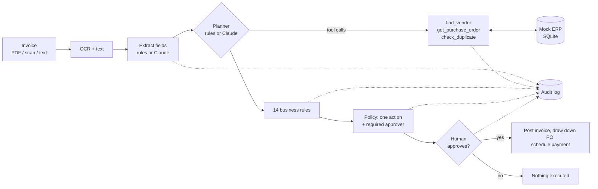

# DocFlow Agent

**An agent that turns vendor invoices into validated, human-approved payment actions.**

Upload an invoice (PDF, scan or text). DocFlow reads it, extracts the fields, checks them against the ERP (vendor master, purchase orders, posted invoices) and the company's payment policy, then proposes one action: pay, request information, escalate, or reject. **Nothing is executed until a person with the right role approves it**, and every step is written to an audit log.

---

## The problem

Accounts-payable teams retype invoices into the ERP by hand: they check the vendor, match the PO, look for duplicates, check the math, and chase vendors for corrections. It's slow, and the expensive mistakes (duplicate payments, paying unknown vendors, going over budget) slip through when people are rushed.

## What it does

| Step | How |
| --- | --- |
| Read | Digital PDFs via text extraction; scans and photos via Tesseract OCR; scanned PDFs fall back to OCR page by page |
| Extract | Invoice number, vendor, dates, PO, currency, subtotal, tax, total, line items, each with a confidence score. Offline rules extractor, or Claude with schema-forced tool calls |
| Verify | Agent tools: `find_vendor` (fuzzy match), `get_purchase_order`, `check_duplicate`. The same tools are exposed over MCP |
| Check | 14 business rules: required fields, line and total math, due date, vendor status, PO open, PO belongs to vendor, PO budget, duplicates, currency |
| Decide | A code-defined policy maps failed checks to one action and the approver role it needs (AP clerk, or finance manager above $5,000) |
| Approve | Human approves or rejects in the UI or API. Approval posts the invoice, draws down the PO and schedules the payment in one transaction |
| Audit | Every extraction, tool call, check, proposal and decision is logged with its inputs and outputs |

## Architecture



### Design decisions

- **The LLM proposes, the policy decides.** With Claude as planner, its suggested action is kept only if the rule-based policy agrees; otherwise the policy's action wins and the override is logged. The approver role always comes from code.
- **Skipped checks are filled in.** If a planner skips a lookup (vendor, PO, duplicate), the agent runs it before checking rules, so a decision never rests on missing evidence.
- **No money moves through the agent.** Approval is a separate, role-checked step. The MCP server can process documents but has no approve tool.
- **Fail safe.** Missing or unreadable fields lead to "request information", never to payment.

## Results

Synthetic, labeled invoices across 9 scenarios (clean, large, duplicate, unknown vendor, blocked vendor, math error, over budget, missing PO, closed PO) and 3 formats, a third of them scanned images read with OCR. Reproduce with `make data && make eval`.

| Metric | Dev set (50, 3 known layouts) | Held-out (50, unseen layout) |
| --- | --- | --- |
| Correct action | 100% | 24% |
| Correct approver role | 100% | 24% |
| All header fields correct | 100% | 0% |
| **Unsafe approvals** (would pay something it shouldn't) | **0** | **0** |
| p50 latency (rules mode) | 4 ms | 4 ms |

How to read this: the rules extractor was tuned on the dev layouts, so 100% there shows the pipeline and policy work, not that it generalizes. On a layout it has never seen, it can't read the fields, but it **fails safe**: every unreadable invoice becomes a request for information, and none is approved for payment. That gap is what the Claude extractor is for (`DOCFLOW_MODE=claude`); the held-out set is the benchmark for it.

## Quick start

```bash
git clone https://github.com/Faisal-161/docflow-agent && cd docflow-agent
python -m venv .venv && source .venv/bin/activate
pip install -e ".[api,ui,mcp,dev]"         # also needs: tesseract-ocr, poppler-utils

docflow process data/samples/*               # propose actions for 6 sample invoices
docflow approve 1 --user maria               # approve as AP clerk
docflow approve 3 --user sam --role finance_manager
docflow audit 1                              # full audit trail

make test     # 29 tests, including "over-eager LLM" policy-override tests
make eval     # dev + held-out metrics
make ui       # Streamlit review screen
make api      # http://localhost:8000/docs
```

Docker: `cp .env.example .env && docker compose up --build`

### Use Claude

```bash
pip install -e ".[llm]"
export DOCFLOW_MODE=claude ANTHROPIC_API_KEY=sk-ant-...
python eval/run_eval.py holdout
```

### MCP (Claude Desktop / Claude Code)

```bash
claude mcp add docflow -- python -m docflow.mcp_server
```

Tools: `find_vendor`, `get_purchase_order`, `check_duplicate`, `process_invoice_text`, `list_documents`.

## API

| Method | Path | Purpose |
| --- | --- | --- |
| POST | `/documents` | Upload a file; returns fields, checks and the proposed action |
| GET | `/documents?status=pending_approval` | Review queue |
| POST | `/documents/{id}/approve` | `{"user": "maria", "role": "ap_clerk"}`; 403 if the role is too junior, 409 if already decided |
| POST | `/documents/{id}/reject` | Reject the proposal; nothing is executed |
| GET | `/documents/{id}/audit` | Every step with inputs and outputs |

## Adapting it for a new customer

See [docs/ONBOARDING.md](docs/ONBOARDING.md): connecting a real ERP, adding a document type, and tuning rules and approval thresholds.

## Project layout

```
docflow/
  ocr.py         PDF text, image OCR, scanned-PDF fallback
  classify.py    invoice / purchase order / receipt
  extract.py     rules extractor with confidence; Claude extractor (forced tool call)
  tools.py       agent tools shared by planners and MCP
  rules.py       business rules, approval policy, LLM override guard
  agent.py       orchestration, planners, human approval
  db.py          mock ERP, review queue, audit log (SQLite)
  api.py         FastAPI      mcp_server.py   MCP server      cli.py   CLI
eval/            synthetic data generator (dev + held-out) and scorer
ui/              Streamlit review screen
```

## Roadmap

- [ ] Claude-mode results on the held-out set
- [ ] Purchase orders and receipts as first-class document types
- [ ] Real email/Slack integration for vendor messages
- [ ] Connectors for a real ERP sandbox (e.g. NetSuite, QuickBooks)

## About

Built by **Md Faisal Islam**, AI Engineer. Also see [MedTrace](https://github.com/Faisal-161/medtrace), a citation-grounded medical RAG system. faisalislam1610@gmail.com

MIT License.
